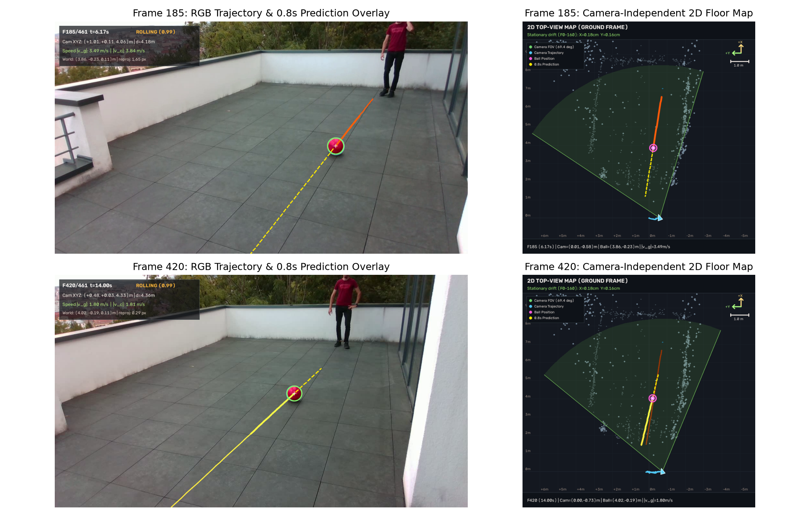
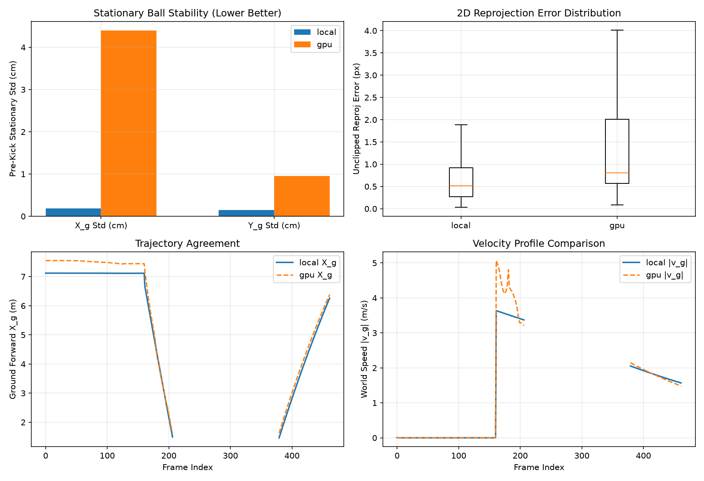

# dotLumen Computer Vision Challenge 3 — 3D Football Tracking & Ground-Aligned 2D Map

Modular 5-stage monocular 3D ball detection, sphere geometry, visual-inertial-free SfM ego-motion, world-frame IMM+RTS tracking, forward trajectory prediction, and ground-aligned 2D mapping pipeline for [`rgb.avi`](rgb.avi) (`1280x720`, `30.0 fps`, `462` frames).

---

## Architecture Rationale

In [`rgb.avi`](rgb.avi), the handheld Intel RealSense D435i pans and translates across the terrace before Kick 1 (`F0–F160`) while the football sits stationary on the tiles. Tracking solely in image or camera coordinates conflates camera motion with ball motion (>2 m/s apparent drift while stationary). This pipeline decouples camera motion cleanly by solving 3D ego-motion and metric terrace ground alignment **before** world-frame state filtering:

```text
rgb.avi ──▶ Stage 1: 2D Detection & Static Masking (YOLO11-seg + Lab/HSV ellipse + blur diff)
                │
                ├──▶ Stage 2: Exact Tangent-Cone Sphere 3D (Penne cubic / minor-axis + ray cov)
                │        │
                ▼        ▼
            Stage 3: Optical-Flow Keyframes + pycolmap SfM + LK PnP + 2-Tier Auto Scale + Gram-Schmidt R_gw
                         │
                         ▼
            Stage 4: 2D Ray-Ground Fusion + 3-Mode IMM + RTS Smoother + soft_l1 Image Opt + 0.8s Rollout
                         │
                         ▼
            Stage 5: Videos (1, 2, 3, 3b) & 3-Sheet Excel/CSV Telemetry
```

Two interchangeable execution profiles share Stages 2, 4, and 5 via `cache/<profile>/`:
- `--profile local` *(default, CPU/local GPU)*: `YOLO11-seg` + `pycolmap` bundle-adjusted SfM + LK PnP.
- `--profile gpu` *(optional cloud GPU upgrade)*: pluggable hooks for `SAM 2.1`/`SAM 3.1` and `DA3-Streaming`.

---

## Setup & CLI Usage

> Note: Raw input media (`rgb.avi`) and the original challenge prompt (`dotLumen_SW-Challenge3.docx`) are excluded via `.gitignore`. Place `rgb.avi` in the repository root to re-run the full pipeline from Stage 1.

### Environment Setup

```powershell
# Using uv (recommended)
uv venv .venv
uv pip install --python .venv\Scripts\python.exe -r requirements.txt

# Or standard venv + pip
python -m venv .venv
.venv\Scripts\python.exe -m pip install -r requirements.txt
```

### Run Pipeline & Tests

```powershell
# Run unit tests (exact sphere math, pose chaining, Gram-Schmidt, IMM+RTS)
.venv\Scripts\python.exe -m pytest tests/ -v

# Run full pipeline end-to-end (default local profile)
.venv\Scripts\python.exe run_pipeline.py --profile local --stage all

# Re-run only downstream stages from cached detections/SfM
.venv\Scripts\python.exe run_pipeline.py --profile local --stage 4,5

# Override detector or VO backend, or compare local vs gpu caches
.venv\Scripts\python.exe run_pipeline.py --profile local --stage 3 --vo sift
.venv\Scripts\python.exe run_pipeline.py --compare-profiles
```

---

## Verified Results (`--profile local`)

| Metric | Observed Result |
|---|---|
| **Unit Tests (`pytest tests/ -v`)** | **19 / 19 passed** |
| **2D Ball Detections (`Stage 1`)** | **290 / 462** frames (`0` false positives across gap `F207-F378`) |
| **Unclipped Ellipse Aspect Ratio (`a/b`)** | **1.069** median (two-tier shadow-tolerant chroma refinement) |
| **Camera Ego-Motion (`Stage 3`)** | **462 / 462** frames localized (`55` optical-flow keyframes, `alpha = 0.07293`, `C_z,g = 1.690 m` median, `[1.630, 1.707] m`) |
| **Pre-Kick Stationary Ball Std (`F0-F160`)** | Raw sphere: `~21.3 cm` -> Ray-ground fused: **`[0.18, 0.16] cm` smoothed XY std** |
| **2D Reprojection Error (Unclipped)** | **Median `0.51 px`**, **P95 `2.29 px`** (all observed: `0.52 px` med / `3.37 px` p95) |

| Segment | Span | Dominant IMM Mode | Speed (Med / Peak) | Ground Travel | Mean `Z_g` | Unclipped Reproj |
|---|---|---|---|---|---|---|
| **Seg 0** | `F0-F160` (`161f`) | `STATIONARY` | `0.00 / 0.01 m/s` | `0.02 m` | `0.110 m` | `0.31 px` |
| **Seg 1** | `F161-F206` (`46f`) | `ROLLING` | `3.50 / 3.64 m/s` | `5.25 m` | `0.110 m` | `1.57 px` |
| **Seg 2** | `F379-F461` (`83f`) | `ROLLING` | `1.80 / 2.05 m/s` | `4.93 m` | `0.110 m` | `0.67 px` |



---

## Deliverables & Repository Structure

- **Video Deliverables (`outputs/`):**
  - `outputs/1_detection_2d.mp4`: Sub-challenge 1 - 2D ellipse/bbox detection overlay with source, diameter, and occlusion/clipping badges.
  - `outputs/2_trajectory_overlay.mp4`: Sub-challenge 3 - 3D-projected historical trail, `0.8 s` dashed physics rollout, and HUD telemetry.
  - `outputs/3_topview_2d_map.mp4`: Sub-challenge 4 - Camera-independent 2D metric floor map with static terrace SfM points, live camera FOV frustum, and stationary drift readout.
  - `outputs/3b_side_by_side_map.mp4`: Synchronized `2000x720` split-screen comparison.
- **Telemetry & Report:**
  - `outputs/ball_3d_telemetry.xlsx` & `outputs/ball_3d_telemetry.csv`: 3 formatted sheets (`Summary & Calibration`, `Frame Telemetry`, `Segment Summary`) with camera-frame and world-frame coordinates/velocities.
  - `dotLumen_SW-Challenge3_Report.docx`: Completed challenge report (Chapters 3 and 4) with mathematical derivations, diagnostic plots (`outputs/plots/`), ablation study, and hardware observability caveats.
- **Source Modules:**
  - `src/config.py`, `src/detector_2d.py`, `src/localizer_3d.py`, `src/ego_motion.py`, `src/tracker_3d.py`, `src/visualizer.py`, `run_pipeline.py`, `tests/test_geometry.py`, `tests/test_gpu_adapters.py`.

---

## Local vs. Cloud GPU Ablation (`SAM 2.1 + DA3-Streaming`)

Stages 1 and 3 were also benchmarked on an NVIDIA RTX A6000 (`--profile gpu`, using `scripts/run_cloud_gpu.sh`) with **SAM 2.1** (`sam2.1_l.pt`) and **Depth Anything 3 Streaming** (`DA3-Streaming`), then evaluated through identical Stages 2 and 4 (`outputs/profile_comparison.csv`):

| Metric | `--profile local` (`YOLO11-seg + pycolmap BA`) | `--profile gpu` (`SAM 2.1 + DA3-Streaming`) |
|---|---|---|
| **Detected Frames / Gap FPs** | `290 / 462` (`0` FP) | `290 / 462` (`0` FP) |
| **Raw Monocular Sphere Std (`F0-158`)** | `20.4 cm` | **`14.6 cm`** (`-28%` depth noise) |
| **Static 3D Map Density / Max Cam Step** | `2,190` pts / `18.5 cm` | **`49,996` pts** / **`7.5 cm`** |
| **Pre-Kick Stationary Std (`X_g, Y_g`)** | **`[0.18, 0.15] cm`** | `[4.40, 0.95] cm` |
| **Unclipped Reproj Error (Med / P95)** | **`0.51 / 2.29 px`** | `0.81 / 3.43 px` |

- **Segmentation (`SAM 2.1` vs. `YOLO + Lab/HSV`):** `SAM 2.1` produced cleaner contours (`a/b = 1.053` vs. `1.069`), reducing raw Stage 2 sphere range noise from `20.4 cm` to `14.6 cm`.
- **Pose Estimation (`pycolmap` BA vs. `DA3-Streaming`):** `DA3-Streaming` yielded smoother camera steps in the fast gap pan and a 23x denser point cloud, but global pixel bundle adjustment in `pycolmap` locked to exact D435i intrinsics `K` was substantially more accurate for sub-centimeter stationary tracking (`0.18 cm` vs. `4.40 cm`). Consequently, `--profile local` is kept as the primary pipeline.



```powershell
# Re-run GPU downstream stages and ablation plot once cache/gpu/ is populated
.venv\Scripts\python.exe run_pipeline.py --profile gpu --stage 2,4 --compare-profiles
```

